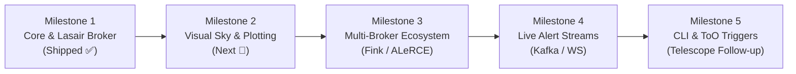

# SkyScout Architecture Roadmap & Feature Backlog

This document outlines the architectural roadmap, active milestones, and feature backlog for **SkyScout**.

SkyScout provides a fast, typed, web-standard toolchain for time-domain astrophysics, Vera C. Rubin Observatory (LSST) transient alerts, broker interfaces, and telescope follow-up scouting.

---

## Roadmap Overview



---

## Milestones & Status

### ✅ Milestone 1: Foundations & Rubin Lasair Client (Completed)

* **`@skyscout/core`**:
  * [x] Time transformations: Modified Julian Date (MJD), Julian Date (JD), UTC `Date`, Unix timestamps.
  * [x] Coordinate geometry: Spherical Vincenty angular separation, normalization, clamp, decimal $\leftrightarrow$ sexagesimal conversions ($HMS / DMS$).
  * [x] Photometry math: Rubin nanoJansky flux $\leftrightarrow$ standard AB magnitude, Taylor series flux error propagation, Signal-to-Noise Ratio (SNR).
* **`@skyscout/lasair-client`**:
  * [x] Lossless JSON parsing (`parseLosslessJson`) preserving 64-bit integer IDs (e.g. `diaObjectId`, `diaSourceId`).
  * [x] Full REST API coverage: `query`, `cone`, `object`, `sherlockObject`, `sherlockPosition`, `annotate`, `annotateList`.
  * [x] Typed responses, comprehensive error hierarchy (`LasairAuthError`, `LasairRateLimitError`, `LasairTimeoutError`).
  * [x] Zero-dependency runtime utilizing web-standard `fetch` and `AbortController`.
* **`apps/skyscout`**:
  * [x] Interactive card-based dashboard with toggleable Demo Mode (mock alerts) and Live API Mode.
  * [x] Candidate filtering (SN, NT, CV, AGN), cone search with field presets, multi-band DIA photometry table, Sherlock host galaxy crossmatches, and annotation submission.
  * [x] Lossless JSON inspector modal.
* **Monorepo Infrastructure**:
  * [x] Turborepo task pipelines (`build`, `test`, `typecheck`, `dev`).
  * [x] Dual ESM (`.js`) and CommonJS (`.cjs`) bundle generation via `tsup`.
  * [x] 100% hermetic unit testing (42 tests in Vitest).
  * [x] Automated npm publishing with OIDC Trusted Publishing provenance via Changesets.

---

### 🚀 Milestone 2: Sky Visualization & Light Curve Plotting (In Planning)

* **Interactive Sky Viewer (`apps/skyscout`)**:
  * [ ] Embed Aladin Lite / HiPS sky visualizer into candidate and cone search views.
  * [ ] Overlay Pan-STARRS, DSS, and Rubin cutout tiles centered on transient coordinates $(RA, Dec)$.
  * [ ] Display cross-match radii and host galaxy ellipses visually.
* **Photometric Light Curve Chart**:
  * [ ] Interactive multi-band light curve plotting component ($u, g, r, i, z, y$) with error bars ($\sigma_m$).
  * [ ] Upper-limit non-detection markers (inverted triangles).
  * [ ] Normalized epoch slider ($MJD - MJD_{\text{peak}}$).
* **Astronomical Utilities (`@skyscout/core`)**:
  * [ ] Galactic coordinate transformations ($l, b \leftrightarrow RA, Dec$).
  * [ ] Ecliptic coordinate transformations ($\lambda, \beta$).
  * [ ] Extinction correction estimation using Schlegel, Finkbeiner & Davis (SFD98) dust maps.

---

### 🔭 Milestone 3: Multi-Broker Alert Ecosystem (Planned)

* **`@skyscout/fink-client`**:
  * [ ] Fully-typed client for the [Fink Broker](https://fink-broker.org/) REST API.
  * [ ] Support for Fink ML anomaly detection scores, classification probabilities, and Solar System object (SSO) ephemeris matching.
* **`@skyscout/alerce-client`**:
  * [ ] Fully-typed client for the [ALeRCE Broker](https://alerce.science/) API.
  * [ ] Stamps classifier probabilities, light curve features, and taxonomy tree matching.
* **`@skyscout/scout-core` (Unified Broker Interface)**:
  * [ ] Abstract broker adapter allowing a single unified query across Lasair, Fink, and ALeRCE.
  * [ ] Normalized candidate schema bridging different broker naming conventions.

---

### ⚡ Milestone 4: Real-Time Alert Streams (Planned)

* **Kafka & Streaming Integration**:
  * [ ] Apache Kafka / WebSocket consumer for live transient alert distribution.
  * [ ] Alert filtering engine based on user-defined criteria (e.g., $m_{AB} < 19$, rise rate $> 0.5$ mag/day, galactic latitude $|b| > 15^\circ$).
  * [ ] Webhook and push notification triggers for urgent astronomical alerts (e.g. Kilonova candidates).

---

### 🖥️ Milestone 5: SkyScout CLI & Telescope Follow-up (Planned)

* **`@skyscout/cli`**:
  * [ ] Command-line tool to query alerts directly from the terminal:
    ```bash
    skyscout query --classification SN --limit 10
    skyscout cone --ra 52.8238 --dec -28.1002 --radius 15
    skyscout lightcurve 170019695992242795
    ```
  * [ ] Output formats: interactive ASCII tables, raw JSON (pipeable to `jq`), and CSV.
* **Target of Opportunity (ToO) & Observatory Planning**:
  * [ ] Target visibility calculator: compute airmass, rise/set/transit times, and Moon angular separation for observatories (e.g. Paranal, La Palma, Mauna Kea).
  * [ ] Export candidate observation blocks to telescope scheduling systems (TOM Toolkit, RTML).

---

## Tracking Issues & Feature Requests

We track bugs, feature requests, and new broker proposals using GitHub Issues and Discussions:

| Purpose | Channel | Template |
| :--- | :--- | :--- |
| 🐛 **Bug Reports** | [GitHub Issues](https://github.com/vilmosioo/skyscout/issues) | [Bug Report Form](https://github.com/vilmosioo/skyscout/issues/new?template=bug_report.yml) |
| 💡 **Feature Requests** | [GitHub Issues](https://github.com/vilmosioo/skyscout/issues) | [Feature Request Form](https://github.com/vilmosioo/skyscout/issues/new?template=feature_request.yml) |
| 🔭 **New Broker / Telescope** | [GitHub Issues](https://github.com/vilmosioo/skyscout/issues) | [Integration Request Form](https://github.com/vilmosioo/skyscout/issues/new?template=broker_request.yml) |
| 💬 **General Discussions & Q&A** | [GitHub Discussions](https://github.com/vilmosioo/skyscout/discussions) | Free-form discussion |

To pick up an open task or submit a contribution, please read our [Contributing Guide](./CONTRIBUTING.md).
