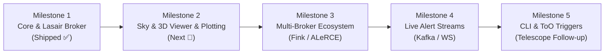

# SkyScout Architecture Roadmap & Feature Backlog

This document outlines the architectural roadmap, active milestones, and feature backlog for **SkyScout**.

SkyScout provides a fast, typed, web-standard toolchain for time-domain astrophysics, Vera C. Rubin Observatory (LSST) transient alerts, broker interfaces, and telescope follow-up scouting.

---

## Roadmap Overview



---

## Milestones & Status

### ✅ Milestone 1: Foundations & Rubin Lasair Client (Completed)

* **`@skyscout/core`**:
  * [x] Time transformations: Modified Julian Date (MJD), Julian Date (JD), UTC `Date`, Unix timestamps.
  * [x] Coordinate geometry: Spherical Vincenty angular separation, normalization, clamp, decimal $\leftrightarrow$ sexagesimal conversions ($HMS / DMS$).
  * [x] Photometry math: Rubin nanoJansky flux $\leftrightarrow$ standard AB magnitude, Taylor series flux error propagation, Signal-to-Noise Ratio (SNR).
* **`@skyscout/lasair-client`**:
  * [x] Lossless JSON parsing (`parseLosslessJson`) preserving 64-bit integer IDs (e.g. `diaObjectId`, `diaSourceId`).
  * [x] Full REST API coverage: `query`, `cone`, `object`, `sherlockObject`, `sherlockPosition`, `annotate`, `annotateList`.
  * [x] Typed responses, comprehensive error hierarchy (`LasairAuthError`, `LasairRateLimitError`, `LasairTimeoutError`).
  * [x] Zero-dependency runtime utilizing web-standard `fetch` and `AbortController`.
* **`apps/skyscout`**:
  * [x] Interactive card-based dashboard with toggleable Demo Mode (mock alerts) and Live API Mode.
  * [x] Candidate filtering (SN, NT, CV, AGN), cone search with field presets, multi-band DIA photometry table, Sherlock host galaxy crossmatches, and annotation submission.
  * [x] Lossless JSON inspector modal.
* **Monorepo Infrastructure**:
  * [x] Turborepo task pipelines (`build`, `test`, `typecheck`, `dev`).
  * [x] Dual ESM (`.js`) and CommonJS (`.cjs`) bundle generation via `tsup`.
  * [x] 100% hermetic unit testing (42 tests in Vitest).
  * [x] Automated npm publishing with OIDC Trusted Publishing provenance via Changesets.

---

### 🚀 Milestone 2: Sky Visualization, 3D Sky Viewer & Light Curve Plotting (In Planning)

* **Interactive Sky Viewer & 3D Celestial Viewer (`apps/skyscout`)**:
  * [ ] Embed Aladin Lite / HiPS sky visualizer into candidate and cone search views.
  * [ ] Overlay Pan-STARRS, DSS, and Rubin cutout tiles centered on transient coordinates $(RA, Dec)$.
  * [ ] Display cross-match radii and host galaxy ellipses visually.
  * [ ] **3D Celestial & Volumetric Viewer**:
    * [ ] Interactive WebGL / Three.js 3D celestial sphere mapping transient coordinates $(RA, Dec)$ onto the sky sphere with survey coverage footprints.
    * [ ] 3D cosmic distance / redshift ($z$) projection mapping transient positions relative to host galaxies and large-scale structures.
    * [ ] Smooth orbital camera controls (fly-to target, pan, zoom, galactic plane reference disk).
* **Photometric Light Curve Chart**:
  * [ ] Interactive multi-band light curve plotting component ($u, g, r, i, z, y$) with error bars ($\sigma_m$).
  * [ ] Upper-limit non-detection markers (inverted triangles).
  * [ ] Normalized epoch slider ($MJD - MJD_{\text{peak}}$).
* **Astronomical Utilities (`@skyscout/core`)**:
  * [ ] Galactic coordinate transformations ($l, b \leftrightarrow RA, Dec$).
  * [ ] Ecliptic coordinate transformations ($\lambda, \beta$).
  * [ ] Extinction correction estimation using Schlegel, Finkbeiner & Davis (SFD98) dust maps.
* **Standalone Schema Packages**:
  * [ ] **`@skyscout/lasair-types`**:
    * [ ] Extract pure Rubin DIA alert schemas (`RubinTransientCandidate`, `RubinObjectResponse`, `RubinDiaSource`, `ConeSearchResult`, `SherlockResponse`, `AnnotationParams`) into a standalone, zero-dependency package published to npm.
    * [ ] Version package to track Lasair API / Rubin schema releases independently of client transport code.
    * [ ] Update `@skyscout/lasair-client` to depend on and re-export `@skyscout/lasair-types` for 100% backward compatibility.

---

### 🔭 Milestone 3: Multi-Broker Alert Ecosystem (Planned)

* **`@skyscout/fink-client`**:
  * [ ] Fully-typed client for the [Fink Broker](https://fink-broker.org/) REST API.
  * [ ] Support for Fink ML anomaly detection scores, classification probabilities, and Solar System object (SSO) ephemeris matching.
* **`@skyscout/alerce-client`**:
  * [ ] Fully-typed client for the [ALeRCE Broker](https://alerce.science/) API.
  * [ ] Stamps classifier probabilities, light curve features, and taxonomy tree matching.
* **`@skyscout/scout-core` (Unified Broker Interface)**:
  * [ ] Abstract broker adapter allowing a single unified query across Lasair, Fink, and ALeRCE.
  * [ ] Normalized candidate schema bridging different broker naming conventions.

---

### ⚡ Milestone 4: Real-Time Alert Streams & Apache Kafka Engine (Planned)

The Vera C. Rubin Observatory (LSST) generates up to 10 million alerts per night as binary **Apache Avro** packets published to **Apache Kafka** clusters. Downstream community brokers (Lasair, Fink, ALeRCE) enrich these alerts with cross-matches (Sherlock, SIMBAD, Gaia) and stream them via dedicated Kafka brokers (e.g., Lasair's `kafka.lsst.ac.uk:9092`).

SkyScout's streaming engine provides a sub-minute, real-time alert processing pipeline to ingest, decode, filter, and stream live Rubin events directly to observers and robotic telescope schedulers.

* **1. Ingestion & Transport Architecture (`@skyscout/kafka`)**:
  * [ ] Initialize `packages/kafka` workspace with TypeScript, Vitest, and `tsup` dual ESM/CJS distribution.
  * [ ] Integrate high-throughput Kafka client (`kafkajs` or native `@confluentinc/kafka-javascript` / `node-rdkafka`).
  * [ ] Connect to Lasair public Kafka broker (`kafka.lsst.ac.uk:9092`), Rubin alert sandboxes, and Fink public streams.
  * [ ] Support SASL/SCRAM, SSL/TLS, and unauthenticated public endpoints.
  * [ ] Dynamic topic discovery and subscription for public transient streams and custom user filter feeds (`lasair_*`).
  * [ ] Configurable consumer group IDs with rebalance listeners and exponential backoff auto-reconnect.

* **2. Binary Apache Avro Deserialization & Typing**:
  * [ ] Fast binary Avro deserialization engine using `avsc` bundling official Rubin / LSST alert schemas (`alert.avsc`, `diaSource.avsc`, `diaObject.avsc`).
  * [ ] Guaranteed 64-bit integer (`BigInt`) preservation for `diaObjectId` and `diaSourceId` to avoid JavaScript IEEE 754 precision loss.
  * [ ] Strongly typed payload mapping into `@skyscout/core` structures (`RubinAlertPacket`).
  * [ ] Resilient schema evolution supporting schema registry wire formats and Rubin Data Preview / Survey releases.

* **3. In-Memory Real-Time Filter & Visibility Gatekeeper**:
  * [ ] Instant magnitude cutoff triggers ($m_{AB} \le \text{threshold}$ in $g$ or $r$).
  * [ ] Transient rise rate detector calculating flux derivatives ($\Delta m / \Delta t > \text{threshold}$ mag/day) to identify fast transients (supernovae shock breakouts, novae, kilonova candidates).
  * [ ] Sherlock classification cross-match filter (`SN`, `CV`, `NT`, `AGN`).
  * [ ] Galactic latitude guard ($|b| \ge 15^\circ$) to filter dense Milky Way stellar fields.
  * [ ] Real-time topocentric Alt/Az horizon gatekeeper using `@skyscout/core` `calculateAltAz()` to instantaneously filter alerts below local observer horizons.
  * [ ] Sliding-window LRU/TTL deduplication cache for `diaObjectId` to prevent duplicate alerts within the same observing block.

* **4. Streaming Gateway & WebSocket Bridge (`services/stream-bridge`)**:
  * [ ] Node.js WebSocket (`ws://`) and Server-Sent Events (SSE) gateway bridging raw Kafka TCP streams to browser clients (`apps/skyscout`).
  * [ ] Bidirectional filter push-down allowing frontend clients to update location or magnitude thresholds on the fly.
  * [ ] Backpressure management and client buffer rate-limiting to protect browser runtimes during peak Rubin alert bursts.

* **5. SkyScout Web UI Real-Time Streaming Mode (`apps/skyscout`)**:
  * [ ] "Live Firehose Stream" toggle alongside on-demand REST queries.
  * [ ] Connection health, ping latency, and throughput metrics (alerts/sec).
  * [ ] Live incoming transient ticker with visual highlight flash on matching targets.
  * [ ] Audio chime and browser notifications for high-priority user-defined alerts.
  * [ ] One-click action to freeze/pause feed for detailed cutout inspection without dropping the stream connection.

* **6. CLI Alert Streamer & Telescope Follow-up (`@skyscout/cli`)**:
  * [ ] Implement `skyscout stream` command:
    ```bash
    skyscout stream --broker lasair --topic lasair_bright_sn --min-alt 30 --lat 51.5 --lon -0.12 --format table
    ```
  * [ ] Pipeable JSON stream output mode compatible with standard UNIX tools and `jq`:
    ```bash
    skyscout stream --format json | jq '.diaObjectId, .mag_ab'
    ```
  * [ ] Webhook triggers to dispatch JSON alerts to Discord, Slack, Telegram, or custom HTTP endpoints.
  * [ ] Direct target export to telescope automation sequencers (N.I.N.A., KStars/Ekos, Voyager, ASCOM/INDI).

* **7. Benchmarking, Mock Streams & Fault Tolerance**:
  * [ ] Hermetic offline mock Kafka test harness generating synthetic Avro Rubin alert bursts for CI.
  * [ ] Throughput benchmarks (targeting $\ge 2,000\text{ alerts/sec}$ per worker core).
  * [ ] Automatic recovery testing for broker network partitions, socket resets, and consumer group rebalances.

---

### 🖥️ Milestone 5: SkyScout CLI & Telescope Follow-up (Planned)

* **`@skyscout/cli`**:
  * [ ] Command-line tool to query alerts directly from the terminal:
    ```bash
    skyscout query --classification SN --limit 10
    skyscout cone --ra 52.8238 --dec -28.1002 --radius 15
    skyscout lightcurve 170019695992242795
    ```
  * [ ] Output formats: interactive ASCII tables, raw JSON (pipeable to `jq`), and CSV.
* **Target of Opportunity (ToO) & Observatory Planning**:
  * [ ] Target visibility calculator: compute airmass, rise/set/transit times, and Moon angular separation for observatories (e.g. Paranal, La Palma, Mauna Kea).
  * [ ] Export candidate observation blocks to telescope scheduling systems (TOM Toolkit, RTML).

---

## Tracking Issues & Feature Requests

We track bugs, feature requests, and new broker proposals using GitHub Issues and Discussions:

| Purpose | Channel | Template |
| :--- | :--- | :--- |
| 🐛 **Bug Reports** | [GitHub Issues](https://github.com/vilmosioo/skyscout/issues) | [Bug Report Form](https://github.com/vilmosioo/skyscout/issues/new?template=bug_report.yml) |
| 💡 **Feature Requests** | [GitHub Issues](https://github.com/vilmosioo/skyscout/issues) | [Feature Request Form](https://github.com/vilmosioo/skyscout/issues/new?template=feature_request.yml) |
| 🔭 **New Broker / Telescope** | [GitHub Issues](https://github.com/vilmosioo/skyscout/issues) | [Integration Request Form](https://github.com/vilmosioo/skyscout/issues/new?template=broker_request.yml) |
| 💬 **General Discussions & Q&A** | [GitHub Discussions](https://github.com/vilmosioo/skyscout/discussions) | Free-form discussion |

To pick up an open task or submit a contribution, please read our [Contributing Guide](./CONTRIBUTING.md).
